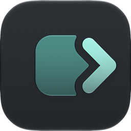

<p align="center">
  
</p>

<h1 align="center">Nextshot</h1>

<p align="center"><strong>Mark up your screen. Hand the fix to your AI coding agent.</strong></p>

Nextshot is a screenshot app for macOS. You select part of the screen, circle what should change, and say what you want in a few words. Nextshot then copies a prompt that Claude Code, Codex, or another AI coding agent can act on.

Nextshot is built on [Capso](https://github.com/lzhgus/Capso), an open-source screenshot and screen recording app. It keeps all of Capso's tools and adds feedback rounds. A round is one run of capturing, marking, and noting, from your first capture to the prompt you copy.

## How it works

1. Press **Option+Shift+F** and drag over the part of the screen you want to change.
2. Mark it up. Press **C** or **N** to drop numbered badges on each problem. Boxes, arrows, and text work too.
3. Press **Command+S**. Nextshot asks one short question per badge: what should change? Type or dictate each answer. Press **Return** to go to the next one.
4. When you finish, the prompt is on your clipboard. Paste it into your agent.

The agent gets your marked-up screenshot, your numbered answers, and the text under each mark. The prompt asks it to write a short plan before it edits anything.

Keep capturing to add more screens to the same round. The **Nshot** item in the menu bar shows how many captures the round holds, for example "Nshot (2)". While a round is active, a small green dot sits on the top right corner of the Nshot mark, and the help box that lists the keys shows a matching dot. Both dots show only while a round is active.

When the round is done, press **Option+Shift+R**. Nextshot copies one prompt for every capture in the round and ends the round.

## The Nshot menu

Click **Nshot** in the menu bar to:

- See which build you run. The top row shows it, for example **Nextshot 2026.10.22 (497)**.
- **Copy Last Capture Prompt** (**Option+Shift+C**) again, for example after dictation replaced your clipboard.
- **Copy Prompt and End Round** (**Option+Shift+R**). Copying the whole prompt ends the round. **Resume Round** in **Recent** reopens it.
- **Open Round Folder** (**Option+Shift+O**) to see the round's files.
- **End Round** (**Option+Shift+E**) when you are done.
- Pick from **Recent** rounds. Check single captures to copy one combined prompt, or **Resume Round** to keep adding to an old round.
- **Change Start Round Shortcut...** to pick a key other than **Option+Shift+F**.
- Open **Settings...**, or **Quit Nextshot**.

The four round keys work only while a round is active. At other times each key types its character as usual. While you select, mark, or add notes to a capture, **Option+Shift+R** and **Option+Shift+E** only beep, so the round never ends under an open capture. **Settings**, **Shortcuts** lists all five Nextshot keys, and each row in the menu shows its key.

Nextshot shows one item in the menu bar. The menu for other captures (window, fullscreen, recording, history) is hidden. To show it, turn on **Show menu bar icon** in **Settings**, **General**. The capture shortcuts work either way.

## Install

1. Open the Nextshot DMG and drag **Nextshot** to **Applications**. Apple notarizes the DMG, so macOS opens it without a warning.
2. Open Nextshot. Allow **Screen Recording** when macOS asks. Nextshot needs it to take screenshots.
3. If Capso is also installed, quit it. Both apps use the same capture shortcuts.

Camera and microphone access are needed only for video recording. Nextshot asks the first time you use them.

## Update

Nextshot does not update itself. When you get a new DMG:

1. Quit Nextshot. Finder cannot replace an app that is running.
2. Open the new DMG and drag **Nextshot** to **Applications**. Choose **Replace**.
3. Open Nextshot again.

Your rounds, settings, and permissions stay.

The Shortcuts actions **Start Feedback Session** and **End Feedback Session** are now **Start Feedback Round** and **End Feedback Round**. A saved Shortcut that uses an old action needs the new action added again.

To see which build you have, open the **Nshot** menu. The top row shows the build date and a build number, for example **Nextshot 2026.10.22 (497)**. A newer date or a higher number is a newer build. The DMG's file name starts with the same date.

The **Check for Updates** button in Preferences does not apply to Nextshot. It finds nothing.

## Your feedback stays on your Mac

- Each round is a folder in `~/Library/Application Support/Nextshot`.
- The feedback code makes no network requests. Nothing leaves your Mac unless you paste it somewhere.
- Text that Nextshot reads from the screen goes to the agent marked as screen text. The agent uses it to find the right code, never as instructions.

## For AI agents

If you are an agent working from a Nextshot prompt, read [How to read a Nextshot bundle](../docs/agents/bundle-guide.md).

## Everything else from Capso

- Area, window, fullscreen, and scrolling screenshots
- Screen recording to MP4 or GIF, with webcam, system audio, and microphone
- Annotation editor, OCR (copy text from the screen), and translation
- Screenshot history, pin to screen, and configurable shortcuts

See [Capso's README](../README.md) for the full list.

## Build from source

You need macOS 15 or later, Xcode, [XcodeGen](https://github.com/yonaskolb/XcodeGen), and an Apple Development certificate.

```bash
scripts/build-local.sh
```

The script builds Nextshot and installs it in `~/Applications`. Developers and coding agents: start with [AGENTS.md](../AGENTS.md).

## Credit and license

Nextshot is a fork of [Capso](https://github.com/lzhgus/Capso) by lzhgus. Capso and this fork are under the [Business Source License 1.1](../LICENSE). Nextshot has its own name and icon, because the license gives no right to Capso's trademark or logo. The icon spec is in [docs/brand](../docs/brand/nextshot-mark.md).
