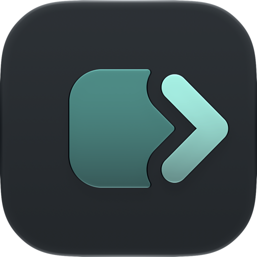
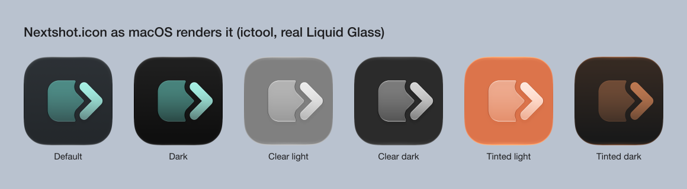
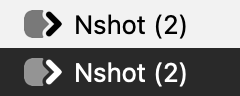

# Nextshot mark

The Nextshot mark is a teal rounded square with a mint chevron on its right edge. The square is the capture. The chevron is the next step: the hand-off to an AI coding agent. A gap cuts the square around the chevron, so the two shapes stay separate at every size.

Approved by Drew on 2026-10-22 (round 9, "chevron right 56"). The reasons are in `docs/decisions/2026-10-22-nextshot-icon.md`.

## Construction

All values are design units on a 1024 canvas. The icon body runs from 100 to 924. Icon Composer's canvas is the body itself, so `scripts/brand/make_nextshot_icon.py` maps 100..924 onto 0..1024.

| Part | Value |
|---|---|
| Square | 380 by 380, centered at (512, 512), corner radius 104 |
| Chevron center line | (660, 380) to (790, 512) to (660, 644) |
| Chevron stroke | 84 wide, round ends, round joint |
| Gap | 48 on each side of the chevron, cut out of the square |
| Cut rounding | 10, so the cut leaves no sharp points |

The gap is a real cut in the square's shape. Never paint it on with the body color. A painted gap shows as a separate layer in the glass rendering and breaks the clear and tinted appearances.

## Color

| Name | Value | Use |
|---|---|---|
| Graphite | #23282C | Body. Icon Composer makes the light-to-dark gradient from it (automatic gradient). |
| Teal | #3CCDBE at 60% opacity | Square |
| Mint | #8FF3E4 | Chevron |

macOS makes the dark, clear, and tinted appearances from these layers. Do not supply custom versions unless one fails a check.

## Sizes

- **App icon:** one vector `.icon` file covers every size. The gap stays visible down to 32 pixels. At 16 pixels it blurs, which is normal for Mac icons at that size.
- **Menu bar:** the mark alone, as a template image, 14 points tall (19 by 14). macOS colors it black or white. The square uses 50% alpha, so it shows as gray. Both menu bar items use it (the capture menu and the Nshot feedback menu), through `ForkBranding.menuBarMark`, so no Capso logo shows.

## Files

| Path | What it is |
|---|---|
| `Branding/Nextshot.icon` | The app icon (Icon Composer). Only `scripts/local-project.yml` uses it. |
| `App/Feedback/FeedbackAssets.xcassets/NextshotMark.imageset` | The menu bar template image |
| `scripts/brand/make_nextshot_icon.py` | Writes both from the values above |
| `docs/brand/*.png` | Previews for this page |
| `.github/assets/nextshot-icon.png` | The README icon |

## Change the mark

1. Edit the values at the top of `scripts/brand/make_nextshot_icon.py`.
2. Run it with Python and shapely: `python3 -m venv /tmp/brand && /tmp/brand/bin/pip install shapely && /tmp/brand/bin/python scripts/brand/make_nextshot_icon.py`.
3. Check every appearance with Icon Composer's `ictool`. For example: `"/Applications/Xcode.app/Contents/Applications/Icon Composer.app/Contents/Executables/ictool" Branding/Nextshot.icon --export-image --output-file /tmp/icon.png --platform macOS --rendition Default --width 512 --height 512 --scale 1`. The renditions are Default, Dark, ClearLight, ClearDark, TintedLight, and TintedDark.
4. Update the previews in `docs/brand/` and `.github/assets/nextshot-icon.png`.

## Chrome Exports

Chrome requires raster extension icons. The browser uses PNG exports of the approved `Branding/Nextshot.icon`, without changing its artwork. Generate them with `python3 -I browser-extension/export-icons.py` on a Mac with Icon Composer. The checked-in 16, 24, 32, 48, and 128 pixel exports serve the toolbar, extension listing, page favicon, and headers. See [Chrome icon formats](https://developer.chrome.com/docs/extensions/reference/manifest/icons).

The macOS app continues to ship the original `.icon` file. The package guard rejects missing browser icons and incorrect pixel dimensions.

## Rules For The Mac App

- Ship the `.icon` file, never a flat PNG app icon. macOS adds the glass, highlights, and shadows.
- Add no custom shine, shadow, bevel, blur, or glow to the layers (Apple Human Interface Guidelines, App icons).
- Keep the gap at 48 or wider.
- Never use Capso's name or logo as Nextshot's icon. Capso's license (`LICENSE`) gives no right to its trademark or logo.
